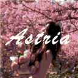

# Astria Token Tool 🌌

<p align="center">
  
</p>

<p align="center">
  <strong>A sleek, high-performance Chrome Extension for Discord token extraction & instant account switching.</strong>
</p>

<p align="center">
  <a href="https://developer.chrome.com/docs/extensions/mv3/intro/"></a>
  <a href="https://opensource.org/licenses/ISC"></a>
  <a href="#installation"></a>
  <a href="#credits"></a>
</p>

---

## ✨ Features

| Feature | Description |
|---|---|
| 🪄 **1-Click Token Extraction** | Instantly extract active Discord authentication tokens from any open tab |
| ⚡ **Fast Token Login** | Switch Discord accounts in seconds — no passwords or cookie clearing needed |
| 🔒 **Privacy & Masking** | Masked token display (`••••••••`) with toggleable visibility for stream/screenshot safety |
| 📋 **One-Tap Copy** | Automatic clipboard copy with instant visual feedback and auto-fill |
| 🎨 **Celestial UI** | Premium glassmorphism dark mode with canvas particle backdrop, glow effects & micro-animations |
| 🛡️ **Manifest V3 Compliant** | Fully CSP-compliant with obfuscation pipeline for source integrity |

---

## 🖼️ Preview

> The extension features a celestial glassmorphism interface with a dynamic 60fps particle canvas background, gradient glow effects, and smooth micro-animations throughout.

---

## 📁 Project Structure

```
Astria Tool Login Tool/
├── icon/                  # Extension icons (16px, 48px, 128px)
│   ├── icon16.png
│   ├── icon48.png
│   └── icon128.png
├── manifest.json          # Chrome Extension Manifest V3 configuration
├── popup.html             # Popup HTML shell
├── popup.css              # Glassmorphism design system & styles
├── popup.js               # Main popup logic & encrypted DOM injector
├── content.js             # Discord content script (token extraction & login)
├── particles.js           # 60fps celestial particle canvas engine
└── README.md              # This file
```

---

## 🚀 Installation

### Chrome / Brave / Microsoft Edge

1. **Clone the repository**
   ```bash
   git clone https://github.com/LordSk-dev/Astria-Tool-Login-Tool.git
   ```

2. **Open Extension Management**
   - Navigate to `chrome://extensions/` (or `edge://extensions/` / `brave://extensions/`)

3. **Enable Developer Mode**
   - Toggle the **Developer mode** switch in the top-right corner

4. **Load Unpacked**
   - Click **Load unpacked**
   - Select the cloned project directory

5. **Navigate to Discord**
   - Open [discord.com](https://discord.com) and click the extension icon in the toolbar

---

## 🔧 How It Works

1. **Extract Token** — Click the extract button while on an active Discord tab. The extension injects a content script to securely retrieve the session token from the browser context.

2. **Copy Token** — One click copies the token to your clipboard with masked display for privacy.

3. **Login with Token** — Paste any valid Discord token and click Login. The extension injects the token into the Discord web client's local storage and reloads the page.

---

## 🔒 Security & Privacy

- ✅ All operations run **locally** within your browser — nothing leaves your machine
- ✅ No tokens or personal data are collected, logged, or transmitted to external servers
- ✅ Fully compatible with official Discord web client sessions
- ✅ Source code is obfuscated for integrity protection

---

## 🛠️ Tech Stack

| Technology | Purpose |
|---|---|
| **Chrome Extension Manifest V3** | Extension framework & permissions |
| **Vanilla JavaScript** | Core logic, DOM injection, token handling |
| **Canvas API** | 60fps particle background animation system |
| **CSS3** | Glassmorphism design, GPU-accelerated animations |
| **Google Fonts (Outfit / JetBrains Mono)** | Typography |
| **Font Awesome 6** | Iconography |

---

## 👥 Community & Support

Join the official Discord community for support, updates, and feedback:

<p align="center">
  <a href="https://discord.gg/astria">
    
  </a>
</p>

---

## 👤 Credits

- **Developer**: Varq
- **Repository**: [LordSk-dev/Astria-Tool-Login-Tool](https://github.com/LordSk-dev/Astria-Tool-Login-Tool)

---

## ⚖️ Disclaimer

> Astria Token Tool is an independent open-source utility and is **not affiliated with or endorsed by Discord Inc.** Use responsibly and in accordance with Discord's Terms of Service.

---

<p align="center">
  Made with 💜 by <strong>Varq</strong>
</p>
# Astria-Tool-Login-Tool 
